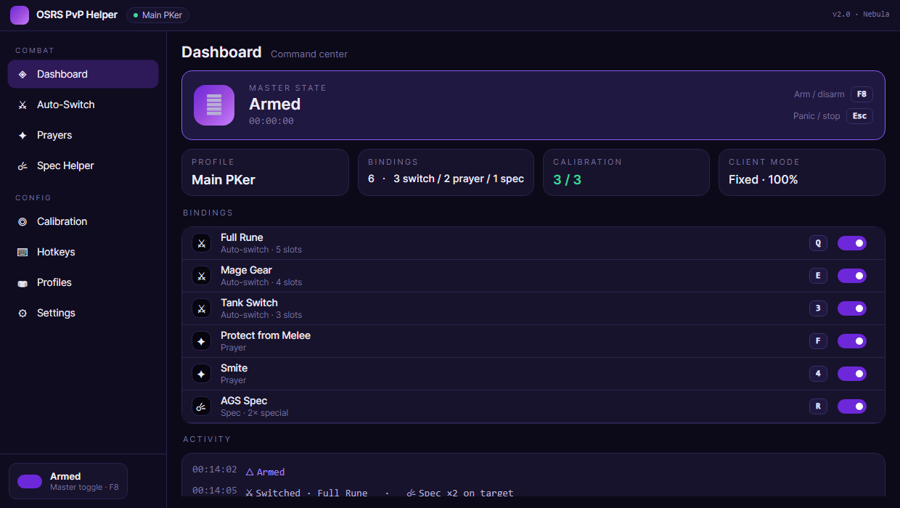
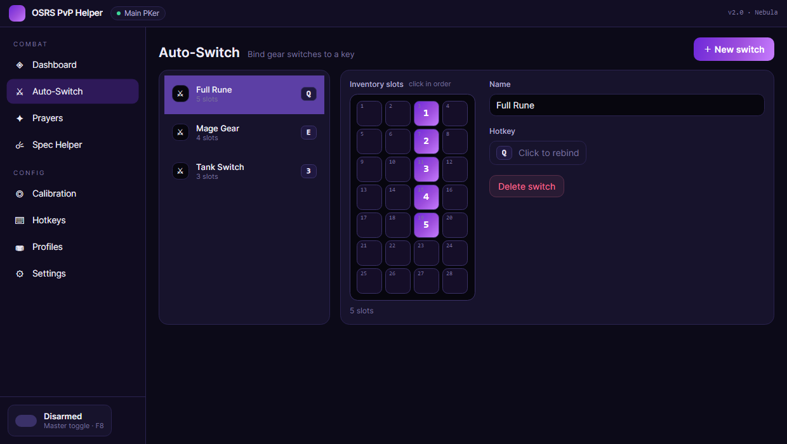
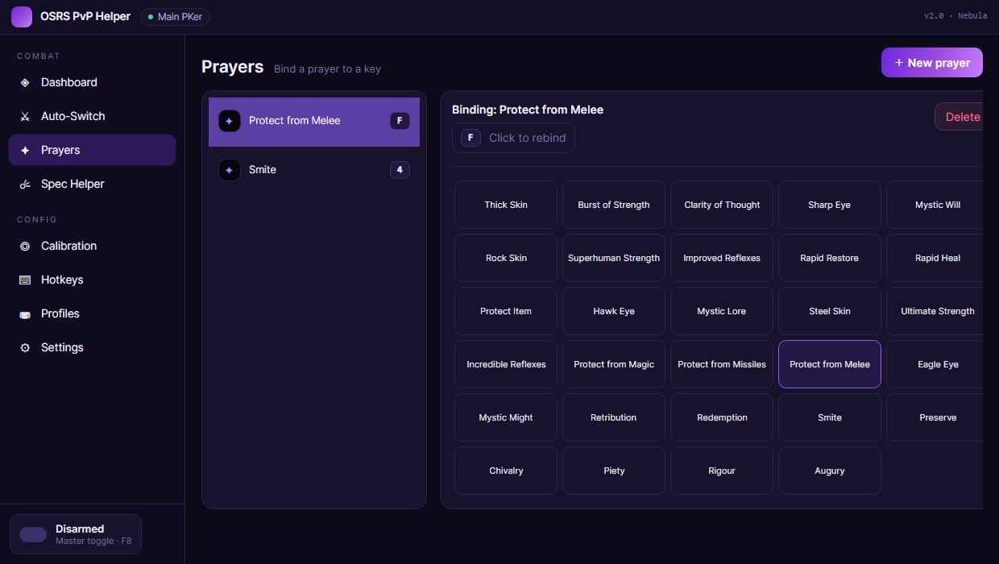
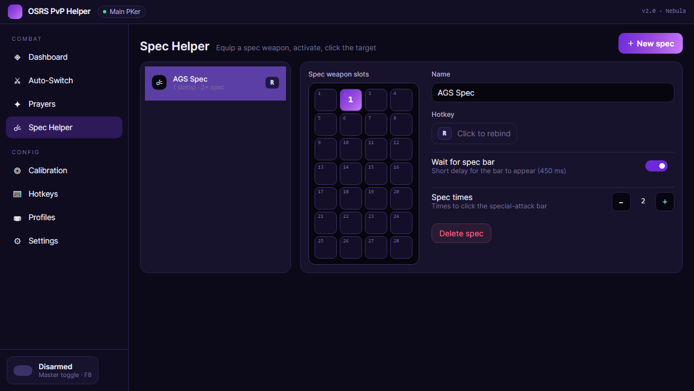
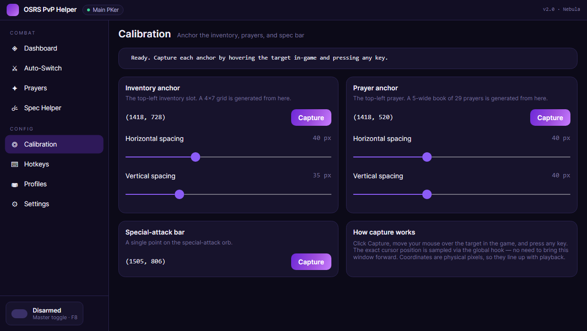
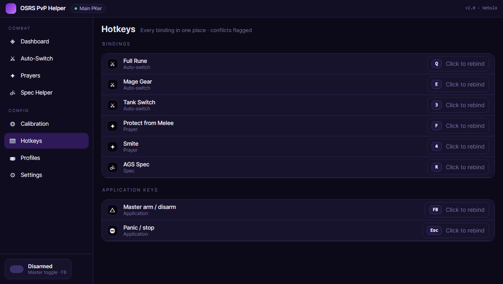
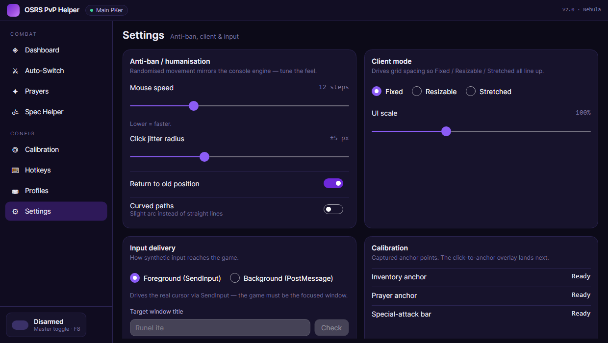

# OSRS PvP Helper — Nebula

A modern **.NET 10 + Avalonia** desktop app for OldSchool RuneScape that automates equipment
switching, prayer switching, and special attacks on global hotkeys. Windows-only, dark-mode-only,
with a deep-space **"Nebula"** theme.

> I do not support or endorse breaking the RuneScape rules — if you get banned, that's on you.



## Features

- **Auto-Switch** — bind a hotkey to a set of inventory slots; a visual 4×7 picker lets you click
  slots in the exact order they should be clicked.
- **Prayers** — bind any of the 29 prayers from a visual prayer book.
- **Spec Helper** — equip a spec weapon, activate, and click the target N times, with an editable
  spec-bar delay.
- **Calibration** — capture anchor points by hovering the target in-game and pressing any key
  (samples the real cursor via a global hook, so coordinates line up with playback).
- **Hotkeys** — every binding plus the master arm/panic keys in one table, with conflict detection.
  Keyboard and **Mouse 4/5** supported. Includes the **in-game tab keys** (Inventory / Prayers /
  Combat) the engine presses to open a panel before clicking it.
- **Profiles** — save, load (hot-swap), duplicate, and delete presets.
- **Settings** — anti-ban/humanisation, Fixed/Resizable/Stretched client mode, and **fully
  configurable engine timings** (move step, pre-click, tab, action gap, switch-click, spec interval).
- **Background input** — drives the game via **PostMessage** to its window, so the game doesn't
  need to be focused (game-dependent). Pick the target from a **dropdown of open windows** in
  Settings (defaults to RuneLite), or match by title.
- **Runtime** — minimises to the system tray with a global arm/disarm hotkey and an always-on-top
  status HUD while armed.

## Screenshots

| Auto-Switch | Prayers | Spec Helper |
|---|---|---|
|  |  |  |
| **Calibration** | **Hotkeys** | **Settings** |
|  |  |  |

## Build & run

Requires the **.NET 10 SDK** (pinned in `global.json`).

```bash
dotnet run --project src/PvPHelper.App
```

Settings and profiles are stored as JSON in `%AppData%\OSRS-PvPHelper`.

## Releases (two flavours)

Run the publish script (PowerShell 7) to produce both Windows x64 builds in `dist/`:

```powershell
pwsh build/publish.ps1
```

| Build | Size | .NET required? | Use it when |
|---|---|---|---|
| **portable** (`OSRS-PvPHelper-portable-win-x64.exe`) | ~48 MB | No — self-contained | You want a single file that runs anywhere |
| **lite** (`OSRS-PvPHelper-lite-win-x64.exe`) | ~12 MB | Yes — [.NET Desktop Runtime 10](https://dotnet.microsoft.com/download/dotnet/10.0) | The runtime is (or can be) installed |

Build just one with `pwsh build/publish.ps1 -Variant lite`. Both drop debug symbols, ship
English-only resources and disable ICU to stay lean; `-Trim` shrinks the portable build further
(experimental — smoke-test it first).

## Project layout

```
OSRS.PvPHelper.slnx
└─ src/
   ├─ PvPHelper.Core    # UI-agnostic domain + automation engine (models, grid math, input, persistence)
   ├─ PvPHelper.App     # Avalonia 12 UI, dark-only Nebula theme, CommunityToolkit MVVM + DI
   └─ PvPHelper.Tests   # unit tests
tools/ScreenshotTool     # renders every page to docs/screenshots via Avalonia headless + Skia
docs/DESIGN_SPEC.md      # the design specification
```

## Built with

- [Avalonia](https://avaloniaui.net/) — cross-platform .NET UI (Windows-only here by choice)
- [CommunityToolkit.Mvvm](https://learn.microsoft.com/dotnet/communitytoolkit/mvvm/)
- [LowLevelInput.Net](https://www.nuget.org/packages/LowLevelInput.Net/) — global keyboard/mouse hook

## License

MIT — see [LICENSE](LICENSE).
